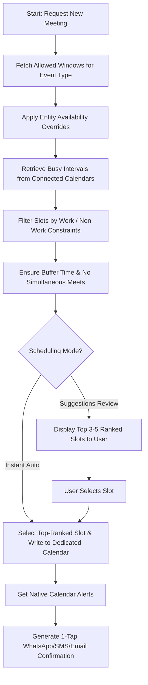

# Syncro: Architectural Specification & Implementation Roadmap

## 1. Executive Summary

**Syncro** is an intelligent, rule-based calendar scheduling application designed to automatically allocate and optimize appointment dates and times across Google Calendar and Apple Calendar without scheduling collisions.

The system addresses both personal scheduling (e.g., social gatherings like "Friends Zone") and complex professional/clinical protocols (e.g., a 1-year clinical research study for Mounjaro requiring bi-monthly visits on specific days and time windows).

---

## 2. Core Architecture & Tech Stack

| Component | Choice | Rationale |
| :--- | :--- | :--- |
| **Framework** | **Flutter (Dart)** | Direct ARM native compilation on iOS & Android; high 60/120 FPS performance; built-in native desktop targets (macOS & Windows). |
| **Local Database** | **Drift (SQLite)** | Reactive, type-safe local storage for instant offline operation and rapid interval queries. |
| **Cloud Sync** | **Supabase / Firebase** | Real-time multi-device sync for Entities, Event Types, and Protocol Roadmaps. |
| **Calendar Sync** | **Hybrid Architecture** | • **Mobile (iOS/Android):** Device Calendar APIs (`device_calendar` / EventKit / CalendarProvider) to sync with native Google and Apple calendars without requiring manual OAuth tokens.<br>• **Desktop (macOS/Windows):** Direct Google Calendar REST API & CalDAV/iCloud integration. |
| **Localization** | **English & Portuguese (pt-BR)** | System locale auto-detection, customizable 12h/24h time display, and localized message templates. |

---

## 3. Domain Model & Entities

```mermaid
erDiagram
    WORK_SCHEDULE ||--o{ USER_SETTINGS : defines
    EVENT_TYPE ||--o{ ENTITY : categorizes
    EVENT_TYPE ||--o{ APPOINTMENT : generates
    ENTITY ||--o{ PROTOCOL_ENROLLMENT : enrolls
    PROTOCOL_ENROLLMENT ||--o{ APPOINTMENT : cascades
    CALENDAR_MAPPING ||--|| EVENT_TYPE : maps_to

    EVENT_TYPE {
        string id PK
        string name
        string colorHex
        string workHoursConstraint // 'work_hours_only' | 'outside_work_hours' | 'both_flexible'
        int durationMinutesMin
        int durationMinutesMax
        int bufferMinutesBefore
        int bufferMinutesAfter
        string schedulingMode
        json allowedTimeWindows
    }

    ENTITY {
        string id PK
        string eventTypeId FK
        string fullName
        string phone
        string email
        json customAvailabilityOverrides
    }

    PROTOCOL_ENROLLMENT {
        string id PK
        string entityId FK
        string protocolName
        date startDate
        date targetEndDate
        int totalVisitsExpected
        int cadenceDays
    }

    APPOINTMENT {
        string id PK
        string entityId FK
        string eventTypeId FK
        datetime startTime
        datetime endTime
        string externalCalendarEventId
        string status
        int visitIndex
    }
```

### 3.1 Key Domain Objects

1. **User Work Schedule**:
   - Configurable work days (e.g., Monday through Friday) and work hours (e.g., 08:00 - 18:00).
   - Sleep / off-limit windows.

2. **Event Type**:
   - Examples: `Friends Zone`, `Mounjaro Clinical Study`.
   - **Time Boundaries**: Whether the event must fall *during* work hours, *outside* work hours, or *both* (any time / flexible).
   - **Allowed Windows**: Specific days and times (e.g., Mondays & Wednesdays 08:00 - 12:00; Thursdays 19:00 - 22:00).
   - **Duration**: Flexible range (e.g., 30m to 90m) or fixed duration.
   - **Buffer Times**: Configurable pre- and post-meeting buffers.
   - **Scheduling Behavior**: `instant_auto` vs. `suggest_top_ranked`.
   - **Calendar Mapping**: Dedicated sub-calendar created in Google/Apple Calendar (e.g., dedicated "Mounjaro Study" calendar).

3. **Entity (Contact / Patient / Friend)**:
   - Associated with one or more Event Types.
   - Profile information (name, phone, contact preference).
   - **Availability Overrides**: e.g., Patient X is only available after 10:00 AM on Wednesdays.

4. **Protocol / Study Roadmap**:
   - Represents structured multi-visit sequences (e.g., 24 visits over 12 months, every 14 days $\pm$ 3 days).
   - **Cascading Shift**: Rescheduling Visit $N$ automatically recalculates suggested dates for Visits $N+1 \dots M$.

---

## 4. Scheduling & Conflict Resolution Engine

The scheduling engine computes optimal slots through an interval intersection algorithm:



### Slot Scoring Criteria
When multiple valid slots are available, candidate slots are ranked by:
1. **Cadence Adherence**: Closeness to the target interval (e.g., exactly 14 days since previous visit).
2. **Compactness**: Grouping clinical appointments consecutively to minimize idle fragmentation.
3. **Entity Preference**: Preferred day/time matching.

---

## 5. User Interface & Screen Structure

The app employs a 5-tab navigation bar:

1. **Agenda (Calendar & Timeline View)**:
   - Daily, weekly, and monthly views showing scheduled meetings across all dedicated event-type calendars.
   - Visual conflict indicators and quick floating action button (+) to schedule.
2. **Event Types**:
   - Management of categories ("Friends Zone", "Mounjaro Study").
   - Rule editor for allowed hours, work/personal flags, duration buffers, and calendar color settings.
3. **Entities (Contacts & Patients)**:
   - Directory of participants with search and filtering by Event Type.
   - Individual entity detail page: protocol progress (e.g., Visit 4 of 24), history, and custom constraints.
4. **Smart Scheduler / Cascades**:
   - Slot finder sandbox: test slot availability, review suggestion cards, and resolve conflicts.
   - Protocol cascading manager: drag to reschedule a visit with immediate preview of downstream shifts.
5. **Settings & Sync**:
   - Work schedule configurator.
   - Connected Google/Apple calendar accounts & permissions.
   - Cloud synchronization status and language switch (EN / PT-BR).

---

## 6. Pre-seeded Realistic Scenarios

To enable immediate testing out of the box, the app will initialize with pre-seeded demo data that can be reset or cleared at any time:

1. **Scenario A: "Friends Zone"**
   - **Entity**: Mendy
   - **Rules**: Outside work hours, Thursday evenings 19:00 - 22:00 or Saturdays 12:00 - 18:00. Duration: 60-90 min. Mode: Suggestions review.
2. **Scenario B: "Clinical Research - Mounjaro Study"**
   - **Entities**: Patient 101, Patient 102
   - **Rules**: Work hours only, Mondays & Wednesdays 08:00 - 12:00. Duration: 45 min + 15 min buffer.
   - **Roadmap**: 1-year study protocol (24 visits, bi-weekly cadence). Mode: Auto-schedule with cascade support.

---

## 7. Phased Implementation Roadmap

- [x] **Phase 1: Environment & Project Bootstrap**
  - Install Flutter toolchain via asdf.
  - Initialize Flutter project with support for Android, iOS, macOS, and Linux/Windows.
  - Set up package dependencies: `drift`, `device_calendar`, `provider`/`bloc`, `intl`, `uuid`.
- [x] **Phase 2: Core Domain Logic & Scheduling Engine**
  - Implement models: `EventType`, `Entity`, `Appointment`, `WorkSchedule`, `ProtocolRoadmap`.
  - Implement slot finder algorithm with conflict checks, buffer offsets, and scoring.
  - Unit tests for single meeting scheduling and cascading protocol shifts.
- [x] **Phase 3: Local Storage & Seed Data**
  - Configure Drift SQLite database schema and DAOs.
  - Add demo seeder for "Friends Zone (Mendy)" and "Mounjaro Study (Patients 101/102)".
- [x] **Phase 4: Calendar Sync Layer**
  - Integrate `device_calendar` plugin for iOS & Android.
  - Implement dedicated sub-calendar creation and bi-directional event read/write.
- [ ] **Phase 5: User Interface Implementation**
  - Implement 5-Tab Navigation structure.
  - Build screens: Agenda, Event Types, Entity Detail with Protocol Roadmaps, Smart Scheduler, and Settings.
  - Integrate 1-tap WhatsApp/SMS/Email confirmation sheet.
  - Implement English & Portuguese (pt-BR) localization.
